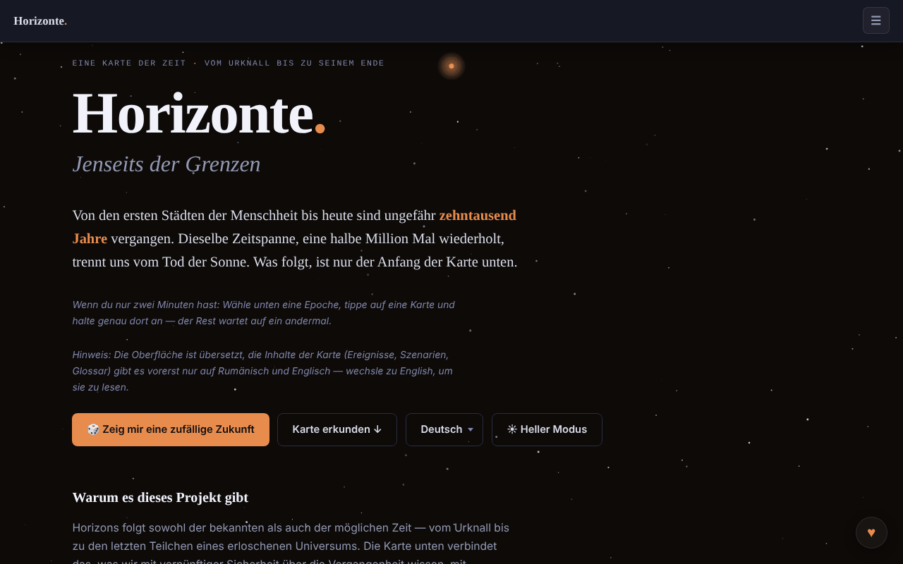

# Horizons. Beyond Limits

[English](README.md) · [Română](README.ro.md) · [Français](README.fr.md) · [Italiano](README.it.md) · [Español](README.es.md) · [Português](README.pt.md) · **Deutsch** · [Magyar](README.hu.md)

**Version:** 1.3.7 · **Zuletzt aktualisiert:** 2026-10-26

Oberflächensprachen: **Română, English, Français, Italiano, Español, Português (PT), Deutsch, Magyar**

Eine Karte der Zeit, vom Urknall bis zum Ende des Universums: 91 Ereignisse, 8 Bereiche, 12 Zeitalter.

**Live:** https://chiuta.github.io/Horizons.BeyondLimits/

## Was es ist

Horizons. Beyond Limits ist eine HTML-App in einer einzigen Datei, die das, was über die Vergangenheit mit vernünftiger Sicherheit bekannt ist, mit Vorhersagen über die Zukunft verbindet, jeweils mit eigenem Vertrauensniveau. Neben der Hauptkarte bietet sie alternative Zweige, eine 2D-/3D-Zeitspirale und Abschnitte über die Natur des Universums, Paradoxien und Leben jenseits der Erde, dargestellt als konkurrierende Szenarien, nicht als Antworten. Die App nennt futuretimeline.net, ein ähnliches Projekt auf Englisch, als erklärtes Vorbild; der Inhalt hier ist original.

## Funktionen

- Die Zeitkarte: 91 Ereignisse, 8 Bereiche, 12 Zeitalter; Auswahl eines Zeitalters und Detailkarten.
- Schaltfläche „🎲 Show me a random future“ (eine zufällige Zukunft).
- „Alternate Branches“: alternative Verläufe, einige wieder mit der Hauptkarte verbunden.
- „The Time Spiral“: die Zeitspirale in 2D- oder 3D-Ansicht (Ziehen, Zoomen, Antippen eines Knotens), mit „Reset view“.
- „The Nature and Purpose of the Universe“: Szenarien, Anti-Szenarien, Nicht-Szenarien und Unmöglichkeiten, mit Filtern.
- „Paradoxes“, „Life Beyond Earth and Advanced Civilizations“, „Thematic Trails“ und „Glossary“.
- **Markdown-Export:** Die Schaltfläche „⬇ Export the map (.md)“ (in die 8 Sprachen übersetzt) lädt alle 91 Ereignisse nach Zeitaltern herunter, in der aktuellen Sprache und unter Beachtung des aktiven Bereichsfilters, mit dem Spekulationshinweis am Ende; die Datei wird lokal im Browser erzeugt. Der Inhalt der Ereignisse liegt nur auf Rumänisch und Englisch vor; in den übrigen Sprachen behält die Datei den rumänischen Text, wie die Karte.
- **Drucken:** Druck-Stylesheets (weißer Hintergrund, schwarzer Text, ohne Navigationsleiste, Bedienelemente oder Sterne; Karten brechen nicht zwischen Seiten). Gedruckt werden das ausgewählte Zeitalter sowie die Abschnitte Szenarien, Paradoxien und Glossar; für die ganze Karte nutze den Markdown-Export.
- Kürzel: `/` setzt den Fokus in das Suchfeld.
- Suche, helles/dunkles Design (Taste ☀) und Oberfläche in 8 Sprachen: English, Română, Français, Italiano, Español, Português, Deutsch, Magyar.
- Tastaturnavigation im Sprachmenü und in den Tabs (Pfeile, Pos1, Ende, Eingabe, Leertaste, Esc).

## Neue Funktionen (1.1.0)

- **CSV-Export** (Schaltfläche „⬇ Export the map (.csv)“ neben dem Markdown-Export): dieselben Ereignisse, in derselben Reihenfolge und mit demselben Bereichsfilter wie beim Markdown-Export, in der aktuellen Sprache; Spalten: Zeitalter, Bereich, Datum, Vertrauen, Titel, Beschreibung (die Kopfzeile ist übersetzt). UTF-8 mit BOM (öffnet sich korrekt in Excel/LibreOffice), Komma als Trennzeichen, Zellen, die mit `=`, `+`, `-` oder `@` beginnen würden, erhalten ein vorangestelltes Apostroph (Formelschutz). Der Inhalt der Ereignisse liegt nur auf Rumänisch und Englisch vor (wie bei Markdown).
- **QR-Code auf Karten** (Schaltfläche ▦ neben ⧉ bei Ereignissen, Zweigen und Szenarien): Der Code enthält die öffentliche Adresse (`https://chiuta.github.io/Horizons.BeyondLimits/` oder die der aktuellen Seite, wenn sie über HTTPS ausgeliefert wird) plus den Permalink `#titel-der-karte`, den die App beim Öffnen auflöst (bereits vorhanden). Die Adresse lässt sich auch kopieren. Lokal erzeugt; erscheint nur mit dem QR-Modul.
- **Fehlertolerante lokale Suche** (ohne Netzwerk, Modul `search` aus fff-kit): Gibt es keinen exakten Treffer (die bestehende Teilstring-Suche bleibt unverändert), werden bis zu 6 nahe Treffer auf Grundlage von Wörtern und Schreibweise angezeigt (BM25, Wortformen, fehlende/vertauschte Buchstaben), mit dem klaren Hinweis, dass sie nicht exakt sind. Z. B. „Big Bangul“, „nucleosynthesys“. Es ist lexikalische Suche, **kein** semantisches Verständnis: Sie findet keine Synonyme, die sich in der Schreibweise nicht ähneln. Der Index wird beim ersten Bedarf aufgebaut (RO oder EN je nach aktueller Sprache; in FR/IT/ES/PT/DE ist der Inhalt weiterhin der rumänische).
- **Transparenz** (durch Drücken der Version in der Fußzeile): Netzwerk (0 externe Anfragen), Speicher (keine Schlüssel), Datei mit SHA-256.
- Drucken: Die neuen Schaltflächen sind im Druck-Stylesheet ausgeblendet.

Die neuen Texte liegen in den 8 Sprachen der App vor (RO, EN, FR, IT, ES, PT, DE, HU); in FR/IT/ES/PT/DE/HU sind die Übersetzungen maschinell erstellt, **nicht von Muttersprachlern geprüft**.

## Kit „fff-kit“

In `index.html` eingefügte Module: `core`, `label`, `bundle`, `qr`, `search` (~140 kB zusätzlich zur App). Ohne sie funktioniert die App genauso (getestet), aber ohne die QR-Schaltflächen und ohne die nahen Treffer; der CSV-Export bleibt.

## Tests

`node tests/fff-r8.test.mjs` (Playwright, Netzwerk blockiert; 36 Prüfungen): CSV Zeile für Zeile mit dem bestehenden Markdown-Export verglichen (Titel, Beschreibungen, Reihenfolge, Filter), unabhängiger CSV-Parser, Formelschutz, QR zurückdekodiert und seine Adresse in einer neuen Seite geöffnet (die Karte erscheint auf dem Bildschirm), Suche mit Tippfehlern in EN/DE, Unsinnszeichenfolge (keine falschen Ergebnisse), 8 Sprachen, axe-core 0 Verstöße (hell/dunkel, Dialog, nahe Ergebnisse), 360 px, ohne das Kit.

## Anleitung

1. Wähle die Sprache im Sprachmenü (English, Română usw.).
2. Drücke „Explore the map ↓“ oder „🎲 Show me a random future“, um zu beginnen.
3. Wähle unter „The scale of time“ ein Zeitalter und öffne eine Karte für Details.
4. Nutze die Links „→ Timeline“, „→ Alternate Branches“, „→ 3D Spiral“, „→ Nature of the Universe“, „→ Paradoxes“, „→ Life Beyond Earth“, „→ Thematic Trails“, „→ Glossary“, um zwischen den Abschnitten zu springen.
5. In der Spirale wechselst du zwischen 2D und 3D; in 3D ziehst und zoomst du, und „Reset view“ stellt die Ansicht wieder her.
6. Im Abschnitt über das Universum filterst du mit All / Scenarios / Anti-scenarios / Non-scenarios / Impossibilities.
7. Wechsle das Design mit der Taste ☀ / ☾.
8. Menüs und Tabs: Pfeile, Pos1/Ende, Eingabe oder Leertaste zum Aktivieren, Esc zum Schließen.

## Datenschutz und Netzwerk

- Die Seite hat eine CSP-Richtlinie (`default-src 'none'`, Skript nur per `sha256`-Hash erlaubt, ohne `'unsafe-inline'` für Skripte; Inline-Stile, `data:`-Bilder), ohne Verbindungen zu anderen Hosts.
- Die App verwendet weder `localStorage`, `sessionStorage` noch IndexedDB und stellt keine Netzwerkanfragen (kein `fetch`, kein CDN, keine externen Skripte); Sprach- und Designauswahl werden zwischen Besuchen nicht gespeichert.
- Sie enthält nur Links, die per Klick geöffnet werden, zu futuretimeline.net und Buy Me a Coffee.

## Warnhinweis

Fiktion / Spekulation: Die Karten der Zukunft sind Extrapolationen und Spekulationen, keine validierten Vorhersagen. Vorhersagen für die nahen Jahrzehnte extrapolieren aktuelle Trends; die für Jahrtausende und ferne Zeitalter sind spekulativ, und die Abschnitte über die Natur des Universums und das Leben jenseits der Erde stellen konkurrierende Erklärungsrahmen dar (Grenzphysik, Philosophie, Theologie, Fiktion; „Dark Forest“ stammt aus einem Science-Fiction-Roman). Dieselbe Klarstellung steht in der Fußzeile der App. Bildungs-/Informationsinhalt; er ersetzt keine wissenschaftlichen Referenzquellen.

## Lokale Nutzung / offline

Lade `index.html` herunter und öffne sie in einem Browser; es wird kein Internet benötigt. Die Bilder `og-image*.png` im Repository dienen nur der Vorschau beim Teilen.

## Lizenz

MIT — siehe Datei `LICENSE`. © 2026 Alexandru-Ionuț Chiuță (Alexio). Eventuelle in der Datei enthaltene Drittanbieter-Bibliotheken behalten ihre eigenen Lizenzen.

## Autor

Alexio — Alexandru-Ionuț Chiuță, Kontakt: alexio@trom.tf

## Zusammenfassung

Horizons. Beyond Limits ist eine HTML-Zeitkarte in einer einzigen Datei, vom Urknall bis zum Ende des Universums: 91 Ereignisse, 8 Bereiche, 12 Zeitalter, alternative Zweige, eine 2D-/3D-Zeitspirale und Abschnitte über die Natur des Universums, Paradoxien und Leben jenseits der Erde. Oberfläche in 8 Sprachen. Sie speichert nichts und stellt keine Netzwerkanfragen; sie verlinkt nur auf futuretimeline.net (ihr erklärtes Vorbild) und Buy Me a Coffee.

## Audit

Audit: 2026-10-10 — die Aussage „kein Netzwerk / kein Speicher“ wurde überprüft (0 `fetch`/XHR/WebSocket, 0 `localStorage`; die einzigen URLs sind `<a>`-Links und OG-Meta). Der Farbkontrast wurde korrigiert, besonders im hellen Design (Akzente der Zeitalter, Sekundärtext), mit axe in beiden Designs geprüft, am Desktop und mobil. Die Lizenz bleibt nicht deklariert.

## Verlauf / Changelog

### 1.3.6 — 2026-10-23

- fff-kit-1.2.0-Audit: Die i18n-Paritätswarnung ist ein Fehlalarm (die Schlüssel werden zur Laufzeit ergänzt); als begründete Ausnahme in `fff.config.json` dokumentiert. Keine funktionale Änderung.

### 1.3.4 — 2026-10-22

fff-kit 1.1.4: Touch-Ziele und Mindestschriftgröße. Touch-Ziele/Text in der App korrigiert.

### 1.3.3 — 2026-10-22

fff-kit 1.1.2: PBKDF2 mit 600.000 Iterationen, Schutz vor Clickjacking.

### 1.3.2 — 2026-10-22
- Mobil: Der Text ist mindestens 12 px groß, und Schaltflächen und Felder haben auf schmalen Bildschirmen größere Touch-Flächen.

- **19. Oktober 2026 (v1.2.0)** — neu: Auf der Karte „Die ersten Menschen auf dem Mond“ (Apollo 11) öffnet der Link „↗ TerRa“ die 2D-Karte der Erde am 20. Juli 1969, 20:17:40 UTC (7 Sprachen).

- **14. Oktober 2026 (v1.1.0)** — neu: CSV-Export, QR-Code auf Karten, fehlertolerante lokale Suche, Fenster „Transparenz“ (fff-kit: core, label, bundle, qr, search); `tests/fff-r8.test.mjs`. CSP: Skript-Hash neu berechnet.

- 1.0.0 — 2026-10-12: Version und Datum der letzten Aktualisierung werden in der App angezeigt
- **11. Oktober 2026** (Runde 7) — die Kopierschaltflächen haben eine Touch-Fläche von mindestens 28×28 px (zuvor 18×14, 104 Ziele unter 24 px bei 360 px); „Show me a random future“ (und Sprünge aus Links) hebt die gewählte Karte stärker und länger (3,6 s) hervor und setzt den Fokus darauf; die Spiralenlegende hat eine Mindesthöhe von 28 px; 0 Fehler, axe 0 Verstöße bei 1280×800 und 360×740.
- **11. Oktober 2026** — Markdown-Export der Karte (nach Bereich gefiltert, in der aktuellen Sprache), Druck-Stylesheets, Kürzel `/` für die Suche, CSP mit Hash für das Skript (ohne `'unsafe-inline'` in `script-src`); mit aktiver CSP getestet (0 Fehler, axe-core 0 Verstöße bei 1280×800 und 360×740).
- **11. Oktober 2026** — die Datumsangaben („vor 4,5 Mrd. Jahren“, „1 Million Jahre“ usw.) sind jetzt in allen 7 Sprachen lokalisiert (zuvor erschienen sie auf Rumänisch und in der englischen Oberfläche); das ☰-Menü schließt sich nach Auswahl von Sprache/Design, bei Eingabe in der Suche, bei Klick außerhalb oder bei Esc; die Erfolgsbenachrichtigungen sind über die ♥-Schaltfläche verschoben, auf zwei begrenzt, schließen sich per Klick und schneller; der „Status“-Text der Szenarien ragt nicht mehr über den 360-px-Bildschirm hinaus.
- Barrierefreiheit und Sicherheit: Der Inhalt ist in einer einzigen `main`-Landmarke gefasst (ein einziges Banner), die Fußzeile und die Hilfspanels liegen in Landmarken; ein CSP-Meta wurde hinzugefügt. axe-core: 0 Verstöße bei 1280×800 und 360×740. Die App hat keine Versionsnummer.

Neu in 1.1.0: CSV-Export der Zeitleiste (dieselben Filter wie beim Markdown-Export), ein QR-Code auf jeder Karte, der auf ihren Permalink zeigt, eine fehlertolerante lokale Suche nach „nahen Treffern“, die nur erscheint, wenn die exakte Suche nichts findet (lexikalisch, nicht semantisch), und der Dialog „Transparenz“. Maschinell übersetzte Zeichenfolgen in FR/IT/ES/PT/DE sind nicht von Muttersprachlern geprüft.
