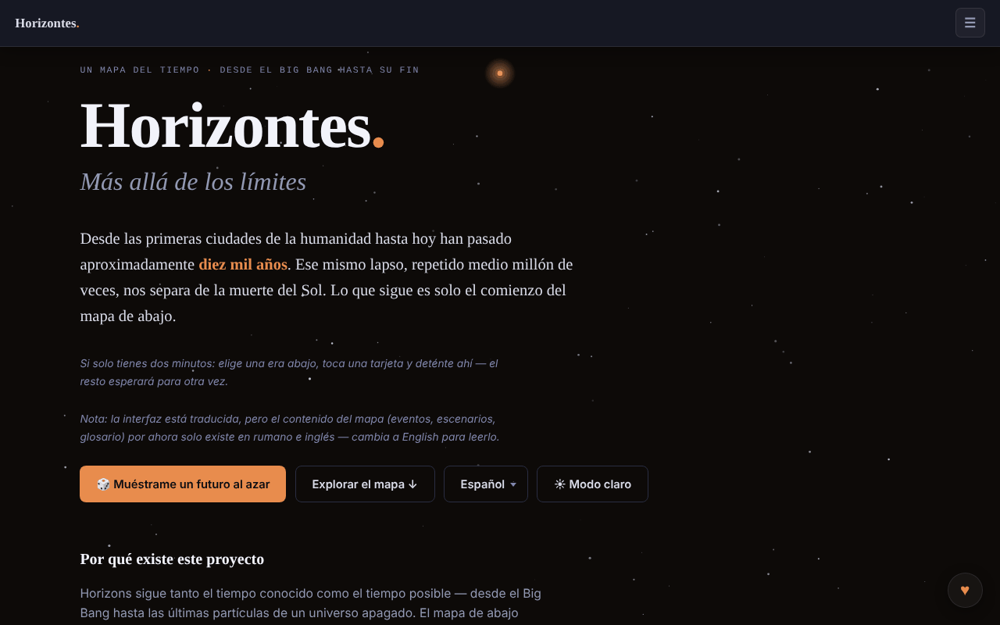

# Horizons. Beyond Limits

[English](README.md) · [Română](README.ro.md) · [Français](README.fr.md) · [Italiano](README.it.md) · **Español** · [Português](README.pt.md) · [Deutsch](README.de.md) · [Magyar](README.hu.md)

**Versión:** 2.2.1 · **Última actualización:** 2026-10-31

Idiomas de la interfaz: **Română, English, Français, Italiano, Español, Português (PT), Deutsch, Magyar**

Un mapa del tiempo, desde el Big Bang hasta el fin del Universo: 91 eventos, 8 ámbitos, 12 eras.

**En línea:** https://chiuta.github.io/Horizons.BeyondLimits/

## Qué es

Horizons. Beyond Limits es una aplicación HTML en un solo archivo que combina lo que se sabe con certeza razonable sobre el pasado con predicciones sobre el futuro, cada una con su propio nivel de confianza. Además del mapa principal, ofrece ramas alternativas, una espiral del tiempo 2D/3D y secciones sobre la naturaleza del Universo, las paradojas y la vida más allá de la Tierra, presentadas como escenarios en competencia, no como respuestas. La aplicación señala como modelo declarado futuretimeline.net, un proyecto similar en inglés; el contenido aquí es original.

## Funciones

- El mapa del tiempo: 91 eventos, 8 ámbitos, 12 eras; elección de una era y tarjetas de detalle.
- Botón «🎲 Show me a random future» (un futuro al azar).
- «Alternate Branches»: trayectorias alternativas, algunas reconectadas con el mapa principal.
- «The Time Spiral»: la espiral del tiempo en vista 2D o 3D (arrastrar, zoom, tocar un nodo), con «Reset view».
- «The Nature and Purpose of the Universe»: escenarios, antiescenarios, no escenarios e imposibilidades, con filtros.
- «Paradoxes», «Life Beyond Earth and Advanced Civilizations», «Thematic Trails» y «Glossary».
- **Exportación a Markdown:** el botón «⬇ Export the map (.md)» (traducido a los 8 idiomas) descarga los 91 eventos, por eras, en el idioma actual y respetando el filtro de ámbitos activo, con la advertencia de especulación al final; el archivo se genera localmente en el navegador. El contenido de los eventos existe solo en rumano e inglés; en los demás idiomas el archivo conserva el texto rumano, igual que el mapa.
- **Impresión:** hojas de estilo de impresión (fondo blanco, texto negro, sin barra de navegación, controles ni estrellas; las tarjetas no se cortan entre páginas). Se imprime la era seleccionada, además de las secciones de escenarios, paradojas y glosario; para todo el mapa usa la exportación a Markdown.
- Atajo: `/` lleva el foco al campo de búsqueda.
- Búsqueda, tema claro/oscuro (botón ☀) e interfaz en 8 idiomas: English, Română, Français, Italiano, Español, Português, Deutsch, Magyar.
- Navegación con teclado en el menú de idiomas y en las pestañas (flechas, Inicio, Fin, Intro, Espacio, Esc).

## Novedades (1.1.0)

- **Exportación a CSV** (botón «⬇ Export the map (.csv)», junto a la exportación a Markdown): los mismos eventos, en el mismo orden y con el mismo filtro de ámbito que la exportación a Markdown, en el idioma actual; columnas: era, ámbito, fecha, confianza, título, descripción (la cabecera está traducida). UTF-8 con BOM (se abre correctamente en Excel/LibreOffice), separador coma, las celdas que empezarían por `=`, `+`, `-` o `@` llevan un apóstrofo delante (protección contra fórmulas). El contenido de los eventos existe solo en rumano e inglés (como en Markdown).
- **Código QR en las tarjetas** (botón ▦ junto a ⧉ en eventos, ramas y escenarios): el código contiene la dirección pública (`https://chiuta.github.io/Horizons.BeyondLimits/`, o la de la página actual si se sirve por HTTPS) más el enlace permanente `#título-de-la-tarjeta`, que la aplicación resuelve al abrirse (ya existente). También se puede copiar la dirección. Generado localmente; aparece solo con el módulo QR.
- **Búsqueda local tolerante a errores** (sin red, módulo `search` de fff-kit): si no hay ninguna coincidencia exacta (la búsqueda existente, por subcadena, queda sin cambios), se muestran hasta 6 coincidencias cercanas según las palabras y la ortografía (BM25, formas de palabras, letras que faltan o cambiadas), con una indicación clara de que no son exactas. P. ej., «Big Bangul», «nucleosynthesys». Es búsqueda léxica, **no** comprensión semántica: no encuentra sinónimos que no se parezcan en la ortografía. El índice se construye la primera vez que hace falta (RO o EN según el idioma actual; en FR/IT/ES/PT/DE el contenido sigue siendo el rumano).
- **Transparencia** (al pulsar la versión en el pie de página): red (0 peticiones externas), almacenamiento (ninguna clave), archivo con SHA-256.
- Impresión: los botones nuevos se ocultan en la hoja de estilo de impresión.

Los textos nuevos están en los 8 idiomas de la aplicación (RO, EN, FR, IT, ES, PT, DE, HU); en FR/IT/ES/PT/DE/HU las traducciones son automáticas, **no verificadas por hablantes nativos**.

## Kit «fff-kit»

Módulos pegados en `index.html`: `core`, `label`, `bundle`, `qr`, `search` (~140 kB sobre la aplicación). Sin ellos la aplicación funciona igual (probado), pero sin los botones QR y sin las coincidencias cercanas; la exportación a CSV permanece.

## Pruebas

`node tests/fff-r8.test.mjs` (Playwright, red bloqueada; 36 comprobaciones): CSV comparado fila a fila con la exportación a Markdown existente (títulos, descripciones, orden, filtro), analizador CSV independiente, protección contra fórmulas, QR decodificado de vuelta y su dirección abierta en una página nueva (la tarjeta aparece en pantalla), búsqueda con errores en EN/DE, cadena sin sentido (sin falsos resultados), 8 idiomas, axe-core 0 violaciones (claro/oscuro, diálogo, resultados cercanos), 360 px, sin el kit.

## Manual de uso

1. Elige el idioma en el menú de idiomas (English, Română, etc.).
2. Pulsa «Explore the map ↓» o «🎲 Show me a random future» para empezar.
3. Elige una era en «The scale of time» y abre una tarjeta para ver los detalles.
4. Usa los enlaces «→ Timeline», «→ Alternate Branches», «→ 3D Spiral», «→ Nature of the Universe», «→ Paradoxes», «→ Life Beyond Earth», «→ Thematic Trails», «→ Glossary» para saltar entre secciones.
5. En la espiral alterna entre 2D y 3D; en 3D arrastra y haz zoom, y «Reset view» restablece la vista.
6. En la sección sobre el Universo filtra con All / Scenarios / Anti-scenarios / Non-scenarios / Impossibilities.
7. Cambia el tema con el botón ☀ / ☾.
8. Menús y pestañas: flechas, Inicio/Fin, Intro o Espacio para activar, Esc para cerrar.

## Privacidad y red

- La página tiene una política CSP (`default-src 'none'`, script permitido solo mediante hash `sha256`, sin `'unsafe-inline'` para scripts; estilos en línea, imágenes `data:`), sin conexiones a otros hosts.
- La aplicación no usa `localStorage`, `sessionStorage` ni IndexedDB y no realiza peticiones de red (sin `fetch`, CDN ni scripts externos); las elecciones de idioma y tema no se conservan entre visitas.
- Contiene solo enlaces, abiertos al hacer clic, a futuretimeline.net y Buy Me a Coffee.

## Advertencia

Ficción / especulación: los mapas del futuro son extrapolaciones y especulaciones, no predicciones validadas. Las predicciones para las próximas décadas extrapolan tendencias actuales; las de milenios y eras lejanas son especulativas, y las secciones sobre la naturaleza del Universo y la vida más allá de la Tierra presentan marcos explicativos en competencia (física de frontera, filosofía, teología, ficción; «Dark Forest» procede de una novela de ciencia ficción). La misma aclaración aparece en el pie de página de la aplicación. Contenido educativo/informativo; no sustituye a las fuentes científicas de referencia.

## Uso local / sin conexión

Descarga `index.html` y ábrelo en un navegador; no necesita internet. Las imágenes `og-image*.png` del repositorio sirven solo para la vista previa al compartir.

## Licencia

MIT — consulta el archivo `LICENSE`. © 2026 Alexandru-Ionuț Chiuță (Alexio). Las eventuales bibliotecas de terceros incluidas en el archivo conservan sus propias licencias.

## Autor

Alexio — Alexandru-Ionuț Chiuță, contacto: alexio@trom.tf

## Resumen

Horizons. Beyond Limits es un mapa del tiempo en HTML de un solo archivo, desde el Big Bang hasta el fin del universo: 91 eventos, 8 ámbitos, 12 eras, ramas alternativas, una espiral del tiempo 2D/3D y secciones sobre la naturaleza del universo, las paradojas y la vida más allá de la Tierra. Interfaz en 8 idiomas. No almacena nada y no realiza peticiones de red; solo enlaza a futuretimeline.net (su modelo declarado) y a Buy Me a Coffee.

## Auditoría

Auditoría: 2026-10-10 — la afirmación «sin red / sin almacenamiento» se verificó (0 `fetch`/XHR/WebSocket, 0 `localStorage`; las únicas URL son enlaces `<a>` y metadatos OG). Se corrigió el contraste de colores, en especial en el tema claro (acentos de las eras, texto secundario), verificado con axe en ambos temas, en escritorio y móvil. La licencia sigue sin declararse.

## Historial / Changelog

### 1.3.6 — 2026-10-23

- Auditoría fff-kit 1.2.0: el aviso de paridad i18n es un falso positivo (las claves se completan en tiempo de ejecución); documentado como excepción justificada en `fff.config.json`. Sin cambios funcionales.

### 1.3.4 — 2026-10-22

fff-kit 1.1.4: áreas táctiles y texto mínimo. Áreas táctiles/texto corregidos en la aplicación.

### 1.3.3 — 2026-10-22

fff-kit 1.1.2: PBKDF2 con 600.000 iteraciones, protección anti-clickjacking.

### 1.3.2 — 2026-10-22
- Móvil: el texto mide al menos 12 px y los botones y campos tienen áreas táctiles mayores en pantallas estrechas.

- **19 de octubre de 2026 (v1.2.0)** — nuevo: en la tarjeta «Los primeros humanos en la Luna» (Apolo 11), el enlace «↗ TerRa» abre el mapa 2D de la Tierra el 20 de julio de 1969, 20:17:40 UTC (7 idiomas).

- **14 de octubre de 2026 (v1.1.0)** — nuevo: exportación a CSV, código QR en las tarjetas, búsqueda local tolerante a errores, ventana «Transparencia» (fff-kit: core, label, bundle, qr, search); `tests/fff-r8.test.mjs`. CSP: hash del script recalculado.

- 1.0.0 — 2026-10-12: la versión y la fecha de la última actualización se muestran en la aplicación
- **11 de octubre de 2026** (ronda 7) — los botones de copia tienen un área táctil de al menos 28×28 px (antes 18×14, 104 objetivos por debajo de 24 px a 360 px); «Show me a random future» (y los saltos desde enlaces) resaltan la tarjeta elegida con más fuerza y durante más tiempo (3,6 s) y le mueven el foco; la leyenda de la espiral tiene una altura mínima de 28 px; 0 errores, axe 0 violaciones a 1280×800 y 360×740.
- **11 de octubre de 2026** — exportación a Markdown del mapa (filtrada por ámbito, en el idioma actual), hojas de estilo de impresión, atajo `/` para la búsqueda, CSP con hash para el script (sin `'unsafe-inline'` en `script-src`); probado con la CSP activa (0 errores, axe-core 0 violaciones a 1280×800 y 360×740).
- **11 de octubre de 2026** — las etiquetas de fecha («hace 4500 millones de años», «1 millón de años», etc.) están ahora localizadas en los 7 idiomas (antes aparecían en rumano y en la interfaz inglesa); el menú ☰ se cierra tras elegir el idioma/tema, al pulsar Intro en la búsqueda, al hacer clic fuera o con Esc; las notificaciones de logros se mueven por encima del botón ♥, se limitan a dos, se cierran al hacer clic y más rápido; el texto «status» de los escenarios ya no desborda la pantalla de 360 px.
- Accesibilidad y seguridad: el contenido está encuadrado en un único punto de referencia `main` (un único banner), el pie de página y los paneles auxiliares están en puntos de referencia; se añadió un meta CSP. axe-core: 0 violaciones a 1280×800 y 360×740. La aplicación no tiene número de versión.

Novedades de la 1.1.0: exportación a CSV de la cronología (mismos filtros que la exportación a Markdown), un código QR en cada tarjeta que apunta a su enlace permanente, una búsqueda local tolerante a errores de «coincidencias cercanas» que se muestra solo cuando la búsqueda exacta no encuentra nada (léxica, no semántica) y el diálogo «Transparencia». Las cadenas traducidas automáticamente en FR/IT/ES/PT/DE no están verificadas por hablantes nativos.
