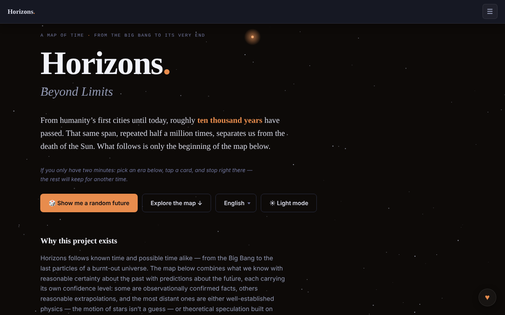

# Horizons. Beyond Limits

[English](README.md) · [Română](README.ro.md) · [Français](README.fr.md) · [Italiano](README.it.md) · [Español](README.es.md) · [Português](README.pt.md) · [Deutsch](README.de.md) · **Magyar**

**Verzió:** 1.3.0 · **Utolsó frissítés:** 2026-10-19

A felület nyelvei: **Română, English, Français, Italiano, Español, Português (PT), Deutsch, Magyar**

Az idő térképe az ősrobbanástól az Univerzum végéig: 91 esemény, 8 terület, 12 korszak.

**Élő verzió:** https://chiuta.github.io/Horizons.BeyondLimits/

## Mi ez

A Horizons. Beyond Limits egyfájlos HTML-alkalmazás, amely egyesíti azt, amit a múltról észszerű bizonyossággal tudunk, a jövőre vonatkozó előrejelzésekkel, mindegyiket saját megbízhatósági szinttel. A fő térkép mellett alternatív ágakat, 2D/3D időspirált, valamint az Univerzum természetéről, a paradoxonokról és a Földön túli életről szóló szakaszokat kínál, versengő forgatókönyvekként, nem válaszokként bemutatva. Az alkalmazás a futuretimeline.net-et, egy hasonló angol nyelvű projektet nevezi meg deklarált mintaként; az itteni tartalom eredeti.

## Funkciók

- Az idő térképe: 91 esemény, 8 terület, 12 korszak; korszakválasztás és részletkártyák.
- „🎲 Show me a random future” gomb (véletlenszerű jövő).
- „Alternate Branches”: alternatív pályák, néhány újra a fő térképhez kapcsolva.
- „The Time Spiral”: az időspirál 2D vagy 3D nézetben (húzás, nagyítás, egy csomópont megérintése), „Reset view” gombbal.
- „The Nature and Purpose of the Universe”: forgatókönyvek, anti-forgatókönyvek, nem-forgatókönyvek és lehetetlenségek, szűrőkkel.
- „Paradoxes”, „Life Beyond Earth and Advanced Civilizations”, „Thematic Trails” és „Glossary”.
- **Markdown-export:** a „⬇ Export the map (.md)” gomb (a 8 nyelvre lefordítva) letölti mind a 91 eseményt korszakok szerint, az aktuális nyelven, az aktív területszűrőt tiszteletben tartva, a végén a spekulációra figyelmeztető megjegyzéssel; a fájl helyben, a böngészőben jön létre. Az események tartalma csak románul és angolul létezik; a többi nyelven a fájl a román szöveget tartja meg, akárcsak a térkép.
- **Nyomtatás:** nyomtatási stíluslapok (fehér háttér, fekete szöveg, navigációs sáv, vezérlők és csillagok nélkül; a kártyák nem törnek oldalak között). A kiválasztott korszak nyomtatódik, valamint a forgatókönyvek, paradoxonok és szószedet szakaszai; a teljes térképhez használd a Markdown-exportot.
- Gyorsbillentyű: a `/` a keresőmezőre viszi a fókuszt.
- Keresés, világos/sötét téma (☀ gomb) és 8 nyelvű felület: English, Română, Français, Italiano, Español, Português, Deutsch, Magyar.
- Billentyűzetes navigáció a nyelvmenüben és a lapokon (nyilak, Home, End, Enter, Szóköz, Esc).

## Újdonságok (1.1.0)

- **CSV-export** (a „⬇ Export the map (.csv)” gomb a Markdown-export mellett): ugyanazok az események, ugyanabban a sorrendben és ugyanazzal a területszűrővel, mint a Markdown-exportnál, az aktuális nyelven; oszlopok: korszak, terület, dátum, megbízhatóság, cím, leírás (a fejléc le van fordítva). UTF-8 BOM-mal (helyesen nyílik meg Excelben/LibreOffice-ban), vessző elválasztó, a `=`, `+`, `-` vagy `@` jellel kezdődő cellák elé aposztróf kerül (képletvédelem). Az események tartalma csak románul és angolul létezik (mint a Markdown esetében).
- **QR-kód a kártyákon** (a ▦ gomb a ⧉ mellett az eseményeknél, ágaknál és forgatókönyveknél): a kód a nyilvános címet (`https://chiuta.github.io/Horizons.BeyondLimits/`, vagy az aktuális oldalét, ha HTTPS-en szolgálják ki) és a `#a-kártya-címe` állandó hivatkozást tartalmazza, amelyet az alkalmazás megnyitáskor feloldoz (ez már létezett). A cím másolható is. Helyben generálódik; csak a QR-modullal jelenik meg.
- **Elírástűrő helyi keresés** (hálózat nélkül, az fff-kit `search` modulja): ha nincs pontos egyezés (a meglévő, részlánc alapú keresés változatlan marad), legfeljebb 6 közeli találat jelenik meg a szavak és a helyesírás alapján (BM25, szóalakok, hiányzó/felcserélt betűk), egyértelmű jelzéssel, hogy nem pontosak. Pl. „Big Bangul”, „nucleosynthesys”. Ez lexikai keresés, **nem** szemantikai megértés: nem találja meg azokat a szinonimákat, amelyek helyesírásban nem hasonlítanak. Az index az első szükségletkor épül fel (RO vagy EN az aktuális nyelvtől függően; FR/IT/ES/PT/DE nyelven a tartalom továbbra is a román).
- **Átláthatóság** (a láblécben a verzióra nyomva): hálózat (0 külső kérés), tárolás (nincs kulcs), fájl SHA-256-tal.
- Nyomtatás: az új gombok el vannak rejtve a nyomtatási stíluslapon.

Az új szövegek az alkalmazás 8 nyelvén vannak (RO, EN, FR, IT, ES, PT, DE, HU); FR/IT/ES/PT/DE/HU nyelven a fordítások gépiek, **anyanyelvi beszélők nem ellenőrizték őket**.

## „fff-kit” kit

Az `index.html`-be illesztett modulok: `core`, `label`, `bundle`, `qr`, `search` (~140 kB az alkalmazás fölött). Nélkülük az alkalmazás ugyanúgy működik (tesztelve), de a QR-gombok és a közeli találatok nélkül; a CSV-export megmarad.

## Tesztek

`node tests/fff-r8.test.mjs` (Playwright, letiltott hálózat; 36 ellenőrzés): a CSV soronként összevetve a meglévő Markdown-exporttal (címek, leírások, sorrend, szűrő), független CSV-értelmező, képletvédelem, visszafejtett QR és a címének megnyitása új oldalon (a kártya megjelenik a képernyőn), keresés elírásokkal EN/DE nyelven, értelmetlen karakterlánc (nincs hamis találat), 8 nyelv, axe-core 0 szabálysértés (világos/sötét, párbeszédablak, közeli találatok), 360 px, kit nélkül.

## Használati útmutató

1. Válaszd ki a nyelvet a nyelvmenüből (English, Română stb.).
2. A kezdéshez nyomd meg az „Explore the map ↓” vagy a „🎲 Show me a random future” gombot.
3. Válassz egy korszakot a „The scale of time” részből, és nyiss meg egy kártyát a részletekhez.
4. A „→ Timeline”, „→ Alternate Branches”, „→ 3D Spiral”, „→ Nature of the Universe”, „→ Paradoxes”, „→ Life Beyond Earth”, „→ Thematic Trails”, „→ Glossary” hivatkozásokkal ugorhatsz a szakaszok között.
5. A spirálban válts 2D és 3D között; 3D-ben húzz és nagyíts, a „Reset view” visszaállítja a nézetet.
6. Az Univerzumról szóló szakaszban szűrj az All / Scenarios / Anti-scenarios / Non-scenarios / Impossibilities lehetőségekkel.
7. A témát a ☀ / ☾ gombbal válthatod.
8. Menük és lapok: nyilak, Home/End, Enter vagy Szóköz az aktiváláshoz, Esc a bezáráshoz.

## Adatvédelem és hálózat

- Az oldalnak CSP-szabályzata van (`default-src 'none'`, a szkript csak `sha256` hash alapján engedélyezett, a szkriptekhez nincs `'unsafe-inline'`; beágyazott stílusok, `data:` képek), más gazdákhoz való kapcsolódás nélkül.
- Az alkalmazás nem használ `localStorage`-t, `sessionStorage`-t vagy IndexedDB-t, és nem indít hálózati kéréseket (nincs `fetch`, CDN vagy külső szkript); a nyelv- és témaválasztás nem őrződik meg a látogatások között.
- Csak kattintásra megnyíló hivatkozásokat tartalmaz a futuretimeline.net és a Buy Me a Coffee felé.

## Figyelmeztetés

Fikció / spekuláció: a jövő térképei extrapolációk és spekulációk, nem igazolt előrejelzések. A közeli évtizedekre vonatkozó előrejelzések a jelenlegi trendeket extrapolálják; az ezredekre és távoli korszakokra vonatkozók spekulatívak, az Univerzum természetéről és a Földön túli életről szóló szakaszok pedig versengő magyarázó kereteket mutatnak be (határfizika, filozófia, teológia, fikció; a „Dark Forest” egy sci-fi regényből származik). Ugyanez a megjegyzés szerepel az alkalmazás láblécében. Oktató/tájékoztató tartalom; nem helyettesíti a tudományos szakirodalmi forrásokat.

## Helyi / offline futtatás

Töltsd le az `index.html` fájlt, és nyisd meg egy böngészőben; nincs szükség internetre. A tárolóban lévő `og-image*.png` képek csak a megosztási előnézetet szolgálják.

## Licenc

MIT — lásd a `LICENSE` fájlt. © 2026 Alexandru-Ionuț Chiuță (Alexio). A fájlba esetleg beépített harmadik féltől származó könyvtárak megtartják saját licencüket.

## Szerző

Alexio — Alexandru-Ionuț Chiuță, elérhetőség: alexio@trom.tf

## Összefoglaló

A Horizons. Beyond Limits egyfájlos HTML-időtérkép az ősrobbanástól az univerzum végéig: 91 esemény, 8 terület, 12 korszak, alternatív ágak, 2D/3D időspirál, valamint az univerzum természetéről, a paradoxonokról és a Földön túli életről szóló szakaszok. 8 felületi nyelv. Nem tárol semmit és nem indít hálózati kéréseket; csak a futuretimeline.net (deklarált mintája) és a Buy Me a Coffee felé tartalmaz hivatkozásokat.

## Audit

Audit: 2026-10-10 — a „nincs hálózat / nincs tárolás” állítás ellenőrizve (0 `fetch`/XHR/WebSocket, 0 `localStorage`; az egyetlen URL-ek `<a>` hivatkozások és OG-metaadatok). A színkontraszt javítva, különösen a világos témában (a korszakok kiemelőszínei, másodlagos szöveg), axe-szel ellenőrizve mindkét témában, asztali gépen és mobilon. A licenc továbbra is deklarálatlan.

## Előzmények / Changelog

- **2026. október 19. (v1.2.0)** — új: az „Első emberek a Holdon” (Apollo 11) kártyán a „↗ TerRa” hivatkozás megnyitja a Föld 2D térképét 1969. július 20-án, 20:17:40 UTC-kor (7 nyelven).

- **2026. október 14. (v1.1.0)** — új: CSV-export, QR-kód a kártyákon, elírástűrő helyi keresés, „Átláthatóság” ablak (fff-kit: core, label, bundle, qr, search); `tests/fff-r8.test.mjs`. CSP: a szkript hash-e újraszámítva.

- 1.0.0 — 2026-10-12: a verzió és az utolsó frissítés dátuma megjelenik az alkalmazásban
- **2026. október 11.** (7. kör) — a másológombok érintési felülete legalább 28×28 px (korábban 18×14, 104 cél 24 px alatt 360 px mellett); a „Show me a random future” (és a hivatkozásokról érkező ugrások) erősebben és tovább (3,6 s) kiemeli a kiválasztott kártyát, és rá viszi a fókuszt; a spirál jelmagyarázatának minimális magassága 28 px; 0 hiba, axe 0 szabálysértés 1280×800 és 360×740 mellett.
- **2026. október 11.** — a térkép Markdown-exportja (terület szerint szűrve, az aktuális nyelven), nyomtatási stíluslapok, a `/` gyorsbillentyű a kereséshez, CSP a szkript hash-ével (a `script-src`-ben `'unsafe-inline'` nélkül); aktív CSP mellett tesztelve (0 hiba, axe-core 0 szabálysértés 1280×800 és 360×740 mellett).
- **2026. október 11.** — a dátumcímkék („4,5 milliárd éve”, „1 millió év” stb.) mostantól mind a 7 nyelven lokalizáltak (korábban románul és az angol felületen jelentek meg); a ☰ menü bezárul a nyelv/téma kiválasztása után, a keresőben Enterre, a rajta kívüli kattintásra vagy Esc-re; az eredményértesítések a ♥ gomb fölé kerültek, kettőre korlátozva, kattintásra és gyorsabban bezáródnak; a forgatókönyvek „státusz” szövege már nem lóg túl a 360 px-es képernyőn.
- Akadálymentesség és biztonság: a tartalom egyetlen `main` mérföldkőbe van foglalva (egyetlen banner), a lábléc és a segédpanelek mérföldkövekben vannak; CSP-meta került be. axe-core: 0 szabálysértés 1280×800 és 360×740 mellett. Az alkalmazásnak nincs verziószáma.

Újdonságok az 1.1.0-ban: az idővonal CSV-exportja (ugyanazokkal a szűrőkkel, mint a Markdown-export), minden kártyán egy QR-kód, amely az állandó hivatkozására mutat, egy elírástűrő helyi „közeli találatok” keresés, amely csak akkor jelenik meg, ha a pontos keresés nem talál semmit (lexikai, nem szemantikai), valamint az „Átláthatóság” párbeszédablak. Az FR/IT/ES/PT/DE nyelven gépi fordítású szövegeket anyanyelvi beszélők nem ellenőrizték.
