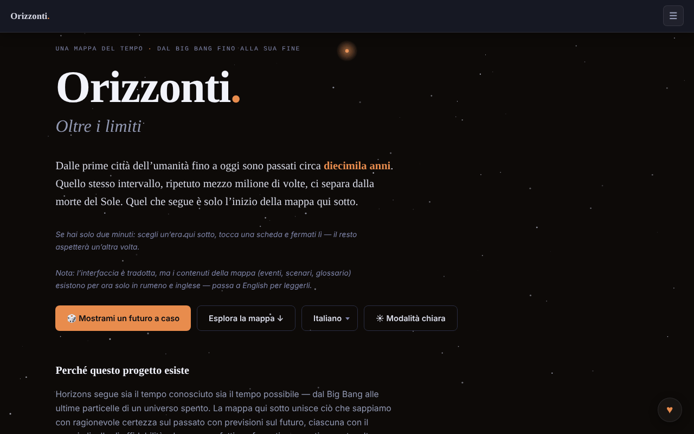

# Horizons. Beyond Limits

[English](README.md) · [Română](README.ro.md) · [Français](README.fr.md) · **Italiano** · [Español](README.es.md) · [Português](README.pt.md) · [Deutsch](README.de.md) · [Magyar](README.hu.md)

**Versione:** 1.3.1 · **Ultimo aggiornamento:** 2026-10-19

Lingue dell'interfaccia: **Română, English, Français, Italiano, Español, Português (PT), Deutsch, Magyar**

Una mappa del tempo, dal Big Bang alla fine dell'Universo: 91 eventi, 8 ambiti, 12 ere.

**Online:** https://chiuta.github.io/Horizons.BeyondLimits/

## Che cos'è

Horizons. Beyond Limits è un'app HTML in un unico file che combina ciò che si sa con ragionevole certezza sul passato con previsioni sul futuro, ciascuna con il proprio livello di fiducia. Oltre alla mappa principale, offre rami alternativi, una spirale del tempo 2D/3D e sezioni sulla natura dell'Universo, sui paradossi e sulla vita oltre la Terra, presentate come scenari in competizione, non come risposte. L'app indica come modello dichiarato futuretimeline.net, un progetto simile in lingua inglese; il contenuto qui è originale.

## Funzioni

- La mappa del tempo: 91 eventi, 8 ambiti, 12 ere; scelta di un'era e schede di dettaglio.
- Pulsante «🎲 Show me a random future» (un futuro a caso).
- «Alternate Branches»: traiettorie alternative, alcune ricollegate alla mappa principale.
- «The Time Spiral»: la spirale del tempo in vista 2D o 3D (trascinamento, zoom, tocco di un nodo), con «Reset view».
- «The Nature and Purpose of the Universe»: scenari, anti-scenari, non-scenari e impossibilità, con filtri.
- «Paradoxes», «Life Beyond Earth and Advanced Civilizations», «Thematic Trails» e «Glossary».
- **Esportazione Markdown:** il pulsante «⬇ Export the map (.md)» (tradotto nelle 8 lingue) scarica tutti i 91 eventi, per ere, nella lingua corrente e rispettando il filtro degli ambiti attivo, con l'avviso di speculazione in fondo; il file viene generato in locale nel browser. Il contenuto degli eventi esiste solo in romeno e in inglese; nelle altre lingue il file mantiene il testo romeno, come la mappa.
- **Stampa:** fogli di stile per la stampa (sfondo bianco, testo nero, senza barra di navigazione, controlli o stelle; le schede non si spezzano tra le pagine). Si stampa l'era selezionata, più le sezioni di scenari, paradossi e glossario; per l'intera mappa usa l'esportazione Markdown.
- Scorciatoia: `/` sposta il focus nel campo di ricerca.
- Ricerca, tema chiaro/scuro (pulsante ☀) e interfaccia in 8 lingue: English, Română, Français, Italiano, Español, Português, Deutsch, Magyar.
- Navigazione da tastiera nel menu delle lingue e nelle schede (frecce, Home, Fine, Invio, Spazio, Esc).

## Novità (1.1.0)

- **Esportazione CSV** (pulsante «⬇ Export the map (.csv)», accanto all'esportazione Markdown): gli stessi eventi, nello stesso ordine e con lo stesso filtro di ambito dell'esportazione Markdown, nella lingua corrente; colonne: era, ambito, data, fiducia, titolo, descrizione (l'intestazione è tradotta). UTF-8 con BOM (si apre correttamente in Excel/LibreOffice), separatore virgola, le celle che inizierebbero con `=`, `+`, `-` o `@` sono precedute da un apostrofo (protezione dalle formule). Il contenuto degli eventi esiste solo in romeno e in inglese (come per Markdown).
- **Codice QR sulle schede** (pulsante ▦ accanto a ⧉ su eventi, rami e scenari): il codice contiene l'indirizzo pubblico (`https://chiuta.github.io/Horizons.BeyondLimits/`, o quello della pagina corrente se servita su HTTPS) più il collegamento permanente `#titolo-della-scheda`, che l'app risolve all'apertura (già esistente). Si può copiare anche l'indirizzo. Generato in locale; compare solo con il modulo QR.
- **Ricerca locale tollerante agli errori** (senza rete, modulo `search` di fff-kit): se non c'è nessuna corrispondenza esatta (la ricerca esistente, per sottostringa, resta invariata), vengono mostrate fino a 6 corrispondenze vicine in base a parole e ortografia (BM25, forme delle parole, lettere mancanti/scambiate), con l'indicazione chiara che non sono esatte. Ad es. «Big Bangul», «nucleosynthesys». È una ricerca lessicale, **non** comprensione semantica: non trova sinonimi che non somigliano nell'ortografia. L'indice viene costruito al primo bisogno (RO o EN a seconda della lingua corrente; in FR/IT/ES/PT/DE il contenuto resta quello romeno).
- **Trasparenza** (premendo la versione nel piè di pagina): rete (0 richieste esterne), archiviazione (nessuna chiave), file con SHA-256.
- Stampa: i nuovi pulsanti sono nascosti nel foglio di stile per la stampa.

I nuovi testi sono nelle 8 lingue dell'app (RO, EN, FR, IT, ES, PT, DE, HU); in FR/IT/ES/PT/DE/HU le traduzioni sono automatiche, **non verificate da madrelingua**.

## Kit «fff-kit»

Moduli incollati in `index.html`: `core`, `label`, `bundle`, `qr`, `search` (~140 kB in più rispetto all'app). Senza di essi l'app funziona allo stesso modo (testato), ma senza i pulsanti QR e senza le corrispondenze vicine; l'esportazione CSV resta.

## Test

`node tests/fff-r8.test.mjs` (Playwright, rete bloccata; 36 verifiche): CSV confrontato riga per riga con l'esportazione Markdown esistente (titoli, descrizioni, ordine, filtro), parser CSV indipendente, protezione dalle formule, QR decodificato e il suo indirizzo aperto in una nuova pagina (la scheda compare a schermo), ricerca con errori in EN/DE, stringa senza senso (nessun falso risultato), 8 lingue, axe-core 0 violazioni (chiaro/scuro, finestra di dialogo, risultati vicini), 360 px, senza il kit.

## Guida all'uso

1. Scegli la lingua dal menu delle lingue (English, Română ecc.).
2. Premi «Explore the map ↓» o «🎲 Show me a random future» per iniziare.
3. Scegli un'era da «The scale of time» e apri una scheda per i dettagli.
4. Usa i link «→ Timeline», «→ Alternate Branches», «→ 3D Spiral», «→ Nature of the Universe», «→ Paradoxes», «→ Life Beyond Earth», «→ Thematic Trails», «→ Glossary» per spostarti tra le sezioni.
5. Nella spirale passa tra 2D e 3D; in 3D trascina e ingrandisci, e «Reset view» ripristina la vista.
6. Nella sezione sull'Universo filtra con All / Scenarios / Anti-scenarios / Non-scenarios / Impossibilities.
7. Cambia tema con il pulsante ☀ / ☾.
8. Menu e schede: frecce, Home/Fine, Invio o Spazio per attivare, Esc per chiudere.

## Privacy e rete

- La pagina ha una politica CSP (`default-src 'none'`, script consentito solo tramite hash `sha256`, senza `'unsafe-inline'` per gli script; stili inline, immagini `data:`), senza connessioni verso altri host.
- L'app non usa `localStorage`, `sessionStorage` né IndexedDB e non effettua richieste di rete (niente `fetch`, CDN o script esterni); le scelte di lingua e tema non vengono conservate tra le visite.
- Contiene solo link, aperti al clic, verso futuretimeline.net e Buy Me a Coffee.

## Avvertenza

Finzione / speculazione: le mappe del futuro sono estrapolazioni e speculazioni, non previsioni validate. Le previsioni sui decenni prossimi estrapolano le tendenze attuali; quelle su millenni ed ere lontane sono speculative, e le sezioni sulla natura dell'Universo e sulla vita oltre la Terra presentano quadri esplicativi in competizione (fisica di frontiera, filosofia, teologia, finzione; «Dark Forest» proviene da un romanzo di fantascienza). La stessa precisazione compare nel piè di pagina dell'app. Contenuto educativo/informativo; non sostituisce le fonti scientifiche di riferimento.

## Uso locale / offline

Scarica `index.html` e aprilo in un browser; non serve Internet. Le immagini `og-image*.png` del repository servono solo per l'anteprima nella condivisione.

## Licenza

MIT — vedi il file `LICENSE`. © 2026 Alexandru-Ionuț Chiuță (Alexio). Eventuali librerie di terze parti incluse nel file mantengono le proprie licenze.

## Autore

Alexio — Alexandru-Ionuț Chiuță, contatto: alexio@trom.tf

## Riepilogo

Horizons. Beyond Limits è una mappa del tempo in HTML a file unico, dal Big Bang alla fine dell'universo: 91 eventi, 8 ambiti, 12 ere, rami alternativi, una spirale del tempo 2D/3D e sezioni sulla natura dell'universo, sui paradossi e sulla vita oltre la Terra. Interfaccia in 8 lingue. Non memorizza nulla e non effettua richieste di rete; contiene solo link a futuretimeline.net (il suo modello dichiarato) e a Buy Me a Coffee.

## Audit

Audit: 2026-10-10 — l'affermazione «senza rete / senza archiviazione» è stata verificata (0 `fetch`/XHR/WebSocket, 0 `localStorage`; gli unici URL sono link `<a>` e meta OG). Corretto il contrasto dei colori, in particolare nel tema chiaro (accenti delle ere, testo secondario), verificato con axe in entrambi i temi, desktop e mobile. La licenza resta non dichiarata.

## Cronologia / Changelog

- **19 ottobre 2026 (v1.2.0)** — nuovo: sulla scheda «I primi uomini sulla Luna» (Apollo 11), il link «↗ TerRa» apre la mappa 2D della Terra al 20 luglio 1969, 20:17:40 UTC (7 lingue).

- **14 ottobre 2026 (v1.1.0)** — nuovo: esportazione CSV, codice QR sulle schede, ricerca locale tollerante agli errori, finestra «Trasparenza» (fff-kit: core, label, bundle, qr, search); `tests/fff-r8.test.mjs`. CSP: hash dello script ricalcolato.

- 1.0.0 — 2026-10-12: la versione e la data dell'ultimo aggiornamento sono mostrate nell'app
- **11 ottobre 2026** (round 7) — i pulsanti di copia hanno un'area tattile di almeno 28×28 px (prima 18×14, 104 bersagli sotto i 24 px a 360 px); «Show me a random future» (e i salti dai link) evidenziano la scheda scelta con maggiore forza e più a lungo (3,6 s) e vi spostano il focus; la legenda della spirale ha un'altezza minima di 28 px; 0 errori, axe 0 violazioni a 1280×800 e 360×740.
- **11 ottobre 2026** — esportazione Markdown della mappa (filtrata per ambito, nella lingua corrente), fogli di stile per la stampa, scorciatoia `/` per la ricerca, CSP con hash per lo script (senza `'unsafe-inline'` in `script-src`); testato con CSP attiva (0 errori, axe-core 0 violazioni a 1280×800 e 360×740).
- **11 ottobre 2026** — le etichette di data («4,5 miliardi di anni fa», «1 milione di anni» ecc.) sono ora localizzate in tutte le 7 lingue (prima comparivano in romeno e nell'interfaccia inglese); il menu ☰ si chiude dopo la scelta della lingua/del tema, con Invio nella ricerca, con un clic all'esterno o con Esc; le notifiche dei traguardi sono spostate sopra il pulsante ♥, limitate a due, si chiudono al clic e più in fretta; il testo «status» degli scenari non supera più lo schermo di 360 px.
- Accessibilità e sicurezza: il contenuto è racchiuso in un unico riferimento `main` (un solo banner), il piè di pagina e i pannelli ausiliari sono in riferimenti; è stato aggiunto un meta CSP. axe-core: 0 violazioni a 1280×800 e 360×740. L'app non ha un numero di versione.

Novità della 1.1.0: esportazione CSV della linea del tempo (stessi filtri dell'esportazione Markdown), un codice QR su ogni scheda che punta al suo collegamento permanente, una ricerca locale tollerante agli errori di «corrispondenze vicine» mostrata solo quando la ricerca esatta non trova nulla (lessicale, non semantica) e la finestra «Trasparenza». Le stringhe tradotte automaticamente in FR/IT/ES/PT/DE non sono verificate da madrelingua.
