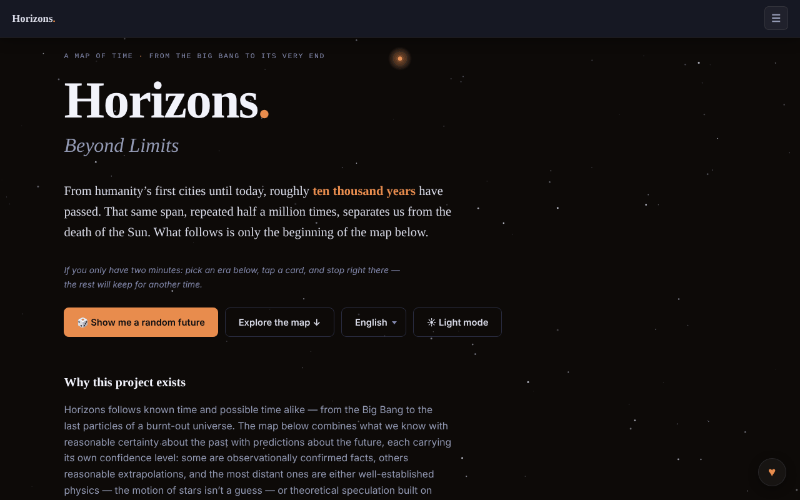

# Horizons. Beyond Limits

**English** · [Română](README.ro.md) · [Français](README.fr.md) · [Italiano](README.it.md) · [Español](README.es.md) · [Português](README.pt.md) · [Deutsch](README.de.md) · [Magyar](README.hu.md)

**Version:** 2.0.0 · **Last updated:** 2026-10-26

Interface languages: **Română, English, Français, Italiano, Español, Português (PT), Deutsch, Magyar**

A map of time, from the Big Bang to the end of the Universe: 91 events, 8 domains, 12 eras.

**Live:** https://chiuta.github.io/Horizons.BeyondLimits/

## What it is

Horizons. Beyond Limits is a single-file HTML app that combines what is known with reasonable certainty about the past with predictions about the future, each with its own confidence level. Besides the main map, it offers alternate branches, a 2D/3D time spiral and sections on the nature of the Universe, paradoxes and life beyond Earth, presented as competing scenarios, not as answers. The app names futuretimeline.net, a similar project in English, as its declared model; the content here is original.

## Features

- **Comparative timeline (v2.0.0):** three time scales (cosmic, geological and life, human) on one logarithmic axis with continuous zoom, drag/keyboard panning and three axes: past (years ago), since the Big Bang (seconds) and future (years from now). Positions are computed from the map's event data (approximate); SVG export. User-defined event collections are not part of this version.
- The time map: 91 events, 8 domains, 12 eras; era selection and detail cards.
- A "🎲 Show me a random future" button (a future at random).
- "Alternate Branches": alternative trajectories, some reconnected to the main map.
- "The Time Spiral": the time spiral in 2D or 3D view (drag, zoom, tapping a node), with "Reset view".
- "The Nature and Purpose of the Universe": scenarios, anti-scenarios, non-scenarios and impossibilities, with filters.
- "Paradoxes", "Life Beyond Earth and Advanced Civilizations", "Thematic Trails" and "Glossary".
- **Markdown export:** the "⬇ Export the map (.md)" button (translated into the 8 languages) downloads all 91 events, by era, in the current language and respecting the active domain filter, with the speculation warning at the end; the file is generated locally in the browser. The events' content exists only in Romanian and English; in the other languages the file keeps the Romanian text, as the map does.
- **Printing:** print style sheets (white background, black text, without the navigation bar, controls or stars; cards do not break across pages). The selected era is printed, plus the scenarios, paradoxes and glossary sections; for the whole map use the Markdown export.
- Shortcut: `/` moves the focus to the search field.
- Search, light/dark theme (☀ button) and an interface in 8 languages: English, Română, Français, Italiano, Español, Português, Deutsch, Magyar.
- Keyboard navigation in the language menu and in the tabs (arrows, Home, End, Enter, Space, Esc).

## New features (1.1.0)

- **CSV export** (the "⬇ Export the map (.csv)" button, next to the Markdown export): the same events, in the same order and with the same domain filter as the Markdown export, in the current language; columns: era, domain, date, confidence, title, description (the header is translated). UTF-8 with BOM (opens correctly in Excel/LibreOffice), comma separator, cells that would start with `=`, `+`, `-` or `@` are prefixed with an apostrophe (formula protection). The events' content exists only in Romanian and English (as with Markdown).
- **QR code on cards** (the ▦ button next to ⧉ on events, branches and scenarios): the code contains the public address (`https://chiuta.github.io/Horizons.BeyondLimits/`, or that of the current page if served over HTTPS) plus the permanent link `#card-title`, which the app resolves on opening (already existing). The address can also be copied. Generated locally; it appears only with the QR module.
- **Typo-tolerant local search** (no network, the `search` module of fff-kit): if there is no exact match (the existing substring search remains unchanged), up to 6 close matches are shown based on words and spelling (BM25, word forms, missing/swapped letters), with a clear note that they are not exact. E.g. "Big Bangul", "nucleosynthesys". This is lexical search, **not** semantic understanding: it does not find synonyms that do not resemble each other in spelling. The index is built on first need (RO or EN depending on the current language; in FR/IT/ES/PT/DE the content is still the Romanian one).
- **Transparency** (by pressing the version in the footer): network (0 external requests), storage (no keys), file with SHA-256.
- Printing: the new buttons are hidden in the print style sheet.

The new texts are in the app's 8 languages (RO, EN, FR, IT, ES, PT, DE, HU); in FR/IT/ES/PT/DE/HU the translations are machine-generated, **not checked by native speakers**.

## "fff-kit" kit

Modules pasted into `index.html`: `core`, `label`, `bundle`, `qr`, `search` (~140 kB on top of the app). Without them the app works the same (tested), but without the QR buttons and without the close matches; the CSV export remains.

## Tests

`node tests/fff-r8.test.mjs` (Playwright, network blocked; 36 checks): CSV compared row by row with the existing Markdown export (titles, descriptions, order, filter), an independent CSV parser, formula protection, the QR decoded back and its address opened in a new page (the card appears on screen), search with typos in EN/DE, a nonsense string (no false results), 8 languages, axe-core 0 violations (light/dark, dialog, close results), 360 px, without the kit.

## User guide

1. Choose the language from the language menu (English, Română, etc.).
2. Press "Explore the map ↓" or "🎲 Show me a random future" to begin.
3. Choose an era from "The scale of time" and open a card for details.
4. Use the links "→ Timeline", "→ Alternate Branches", "→ 3D Spiral", "→ Nature of the Universe", "→ Paradoxes", "→ Life Beyond Earth", "→ Thematic Trails", "→ Glossary" to jump between sections.
5. In the spiral, switch between 2D and 3D; in 3D, drag and zoom, and "Reset view" restores the view.
6. In the Universe section, filter with All / Scenarios / Anti-scenarios / Non-scenarios / Impossibilities.
7. Switch the theme with the ☀ / ☾ button.
8. Menus and tabs: arrows, Home/End, Enter or Space to activate, Esc to close.

## Privacy and network

- The page has a CSP policy (`default-src 'none'`, script allowed only by `sha256` hash, without `'unsafe-inline'` for scripts; inline styles, `data:` images), with no connections to other hosts.
- The app does not use `localStorage`, `sessionStorage` or IndexedDB and makes no network requests (no `fetch`, CDN or external scripts); language and theme choices are not retained between visits.
- It contains only links, opened on click, to futuretimeline.net and Buy Me a Coffee.

## Warning

Fiction / speculation: the maps of the future are extrapolations and speculation, not validated predictions. Predictions for the coming decades extrapolate current trends; those for millennia and distant eras are speculative, and the sections on the nature of the Universe and life beyond Earth present competing explanatory frameworks (frontier physics, philosophy, theology, fiction; "Dark Forest" comes from a science-fiction novel). The same statement appears in the app's footer. Educational/informative content; it does not replace reference scientific sources.

## Local / offline use

Download `index.html` and open it in a browser; it needs no internet. The `og-image*.png` images in the repository serve only for share previews.

## License

MIT — see the `LICENSE` file. © 2026 Alexandru-Ionuț Chiuță (Alexio). Any third-party libraries included in the file keep their own licenses.

## Author

Alexio — Alexandru-Ionuț Chiuță, contact: alexio@trom.tf

## Summary

Horizons. Beyond Limits is a single-file HTML map of time from the Big Bang to the end of the universe: 91 events, 8 domains, 12 eras, alternate branches, a 2D/3D time spiral, and sections on the nature of the universe, paradoxes and life beyond Earth. 8 UI languages. It stores nothing and makes no network requests; it only links to futuretimeline.net (its stated model), Buy Me a Coffee.

## Audit

Audit: 2026-10-10 — the "no network / no storage" claim verified (0 `fetch`/XHR/WebSocket, 0 `localStorage`; the only URLs are `<a>` links and OG meta). Fixed colour contrast, especially in the light theme (era accents, secondary text), verified with axe in both themes, desktop and mobile. The license remains undeclared.

## History / Changelog

### 1.3.6 — 2026-10-23

- fff-kit 1.2.0 audit: the i18n-parity warning is a false positive (the keys are completed at run time); documented as a justified exception in `fff.config.json`. No functional change.

### 1.3.4 — 2026-10-22

fff-kit 1.1.4: touch targets and minimum text size. Touch targets/text fixed in the app.

### 1.3.3 — 2026-10-22

fff-kit 1.1.2: PBKDF2 with 600,000 iterations, anti-clickjacking protection.

### 1.3.2 — 2026-10-22
- Mobile: text is at least 12 px and buttons and fields have larger touch targets on narrow screens.

- **19 October 2026 (v1.2.0)** — new: on the "First humans on the Moon" card (Apollo 11), the "↗ TerRa" link opens the 2D map of the Earth on 20 July 1969, 20:17:40 UTC (7 languages).

- **14 October 2026 (v1.1.0)** — new: CSV export, QR code on cards, typo-tolerant local search, the "Transparency" window (fff-kit: core, label, bundle, qr, search); `tests/fff-r8.test.mjs`. CSP: the script hash recalculated.

- 1.0.0 — 2026-10-12: the version and the date of the last update are shown in the app
- **11 October 2026** (round 7) — the copy buttons have a touch target of at least 28×28 px (previously 18×14, 104 targets under 24 px at 360 px); "Show me a random future" (and jumps from links) highlight the chosen card more strongly and for longer (3.6 s) and move focus to it; the spiral legend has a minimum height of 28 px; 0 errors, axe 0 violations at 1280×800 and 360×740.
- **11 October 2026** — Markdown export of the map (filtered by domain, in the current language), print style sheets, the `/` shortcut for search, CSP with a hash for the script (without `'unsafe-inline'` in `script-src`); tested with CSP active (0 errors, axe-core 0 violations at 1280×800 and 360×740).
- **11 October 2026** — the date labels ("4.5 billion years ago", "1 million years", etc.) are now localized in all 7 languages (previously they appeared in Romanian and in the English interface); the ☰ menu closes after choosing the language/theme, on Enter in search, on click outside or on Esc; achievement notifications are moved above the ♥ button, limited to two, close on click and faster; the scenarios' "status" text no longer overflows the 360 px screen.
- Accessibility and security: the content is wrapped in a single `main` landmark (a single banner), the footer and auxiliary panels are in landmarks; a CSP meta was added. axe-core: 0 violations at 1280×800 and 360×740. The app has no version number.

New in 1.1.0: CSV export of the timeline (same filters as the Markdown export), a QR code on each card pointing to its permalink, a local typo-tolerant "close matches" search shown only when the exact search finds nothing (lexical, not semantic), and the "Transparency" dialog. Machine-translated strings in FR/IT/ES/PT/DE are not native-checked.
