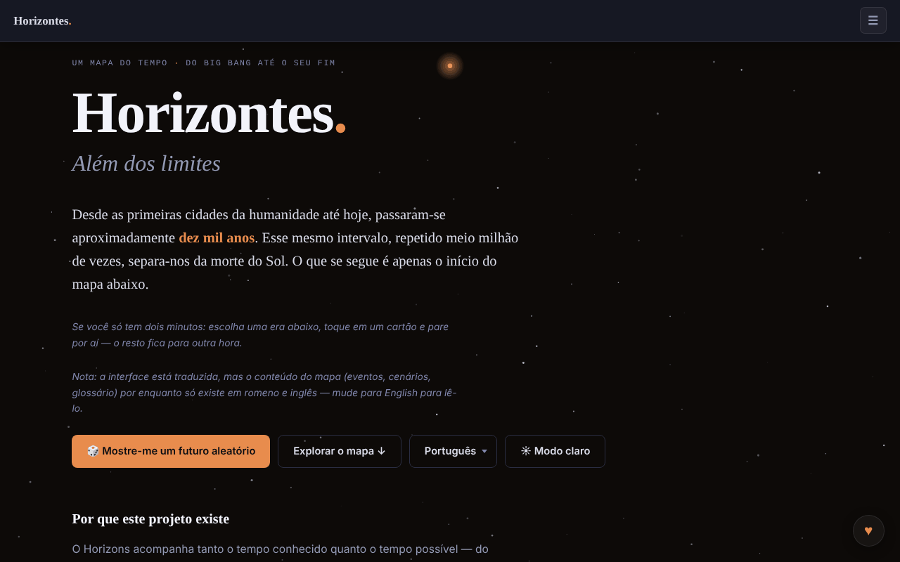

# Horizons. Beyond Limits

[English](README.md) · [Română](README.ro.md) · [Français](README.fr.md) · [Italiano](README.it.md) · [Español](README.es.md) · **Português** · [Deutsch](README.de.md) · [Magyar](README.hu.md)

**Versão:** 1.3.5 · **Última atualização:** 2026-10-23

Idiomas da interface: **Română, English, Français, Italiano, Español, Português (PT), Deutsch, Magyar**

Um mapa do tempo, desde o Big Bang até ao fim do Universo: 91 eventos, 8 domínios, 12 eras.

**Online:** https://chiuta.github.io/Horizons.BeyondLimits/

## O que é

O Horizons. Beyond Limits é uma aplicação HTML num único ficheiro que combina o que se sabe com certeza razoável sobre o passado com previsões sobre o futuro, cada uma com o seu próprio nível de confiança. Além do mapa principal, oferece ramos alternativos, uma espiral do tempo 2D/3D e secções sobre a natureza do Universo, os paradoxos e a vida para além da Terra, apresentadas como cenários concorrentes, não como respostas. A aplicação indica como modelo declarado o futuretimeline.net, um projeto semelhante em inglês; o conteúdo aqui é original.

## Funcionalidades

- O mapa do tempo: 91 eventos, 8 domínios, 12 eras; escolha de uma era e cartões de detalhe.
- Botão «🎲 Show me a random future» (um futuro ao acaso).
- «Alternate Branches»: trajetórias alternativas, algumas religadas ao mapa principal.
- «The Time Spiral»: a espiral do tempo em vista 2D ou 3D (arrastar, zoom, tocar num nó), com «Reset view».
- «The Nature and Purpose of the Universe»: cenários, anticenários, não cenários e impossibilidades, com filtros.
- «Paradoxes», «Life Beyond Earth and Advanced Civilizations», «Thematic Trails» e «Glossary».
- **Exportação para Markdown:** o botão «⬇ Export the map (.md)» (traduzido nos 8 idiomas) descarrega os 91 eventos, por eras, no idioma atual e respeitando o filtro de domínios ativo, com o aviso de especulação no final; o ficheiro é gerado localmente no navegador. O conteúdo dos eventos existe apenas em romeno e inglês; nos restantes idiomas o ficheiro mantém o texto romeno, tal como o mapa.
- **Impressão:** folhas de estilo de impressão (fundo branco, texto preto, sem barra de navegação, controlos nem estrelas; os cartões não se partem entre páginas). Imprime-se a era selecionada, mais as secções de cenários, paradoxos e glossário; para todo o mapa use a exportação para Markdown.
- Atalho: `/` move o foco para o campo de pesquisa.
- Pesquisa, tema claro/escuro (botão ☀) e interface em 8 idiomas: English, Română, Français, Italiano, Español, Português, Deutsch, Magyar.
- Navegação pelo teclado no menu de idiomas e nos separadores (setas, Home, End, Enter, Espaço, Esc).

## Novidades (1.1.0)

- **Exportação para CSV** (botão «⬇ Export the map (.csv)», ao lado da exportação para Markdown): os mesmos eventos, pela mesma ordem e com o mesmo filtro de domínio da exportação para Markdown, no idioma atual; colunas: era, domínio, data, confiança, título, descrição (o cabeçalho está traduzido). UTF-8 com BOM (abre corretamente no Excel/LibreOffice), separador vírgula, as células que começariam por `=`, `+`, `-` ou `@` levam um apóstrofo à frente (proteção contra fórmulas). O conteúdo dos eventos existe apenas em romeno e inglês (como no Markdown).
- **Código QR nos cartões** (botão ▦ ao lado de ⧉ nos eventos, ramos e cenários): o código contém o endereço público (`https://chiuta.github.io/Horizons.BeyondLimits/`, ou o da página atual se for servida por HTTPS) mais a ligação permanente `#título-do-cartão`, que a aplicação resolve ao abrir (já existente). Pode também copiar-se o endereço. Gerado localmente; surge apenas com o módulo QR.
- **Pesquisa local tolerante a erros** (sem rede, módulo `search` do fff-kit): se não existir nenhuma correspondência exata (a pesquisa existente, por subcadeia, mantém-se inalterada), são apresentadas até 6 correspondências próximas com base nas palavras e na ortografia (BM25, formas de palavras, letras em falta ou trocadas), com a indicação clara de que não são exatas. P. ex., «Big Bangul», «nucleosynthesys». É pesquisa lexical, **não** compreensão semântica: não encontra sinónimos que não se pareçam na ortografia. O índice é construído na primeira necessidade (RO ou EN consoante o idioma atual; em FR/IT/ES/PT/DE o conteúdo continua a ser o romeno).
- **Transparência** (ao premir a versão no rodapé): rede (0 pedidos externos), armazenamento (nenhuma chave), ficheiro com SHA-256.
- Impressão: os botões novos ficam ocultos na folha de estilo de impressão.

Os textos novos estão nos 8 idiomas da aplicação (RO, EN, FR, IT, ES, PT, DE, HU); em FR/IT/ES/PT/DE/HU as traduções são automáticas, **não verificadas por falantes nativos**.

## Kit «fff-kit»

Módulos colados no `index.html`: `core`, `label`, `bundle`, `qr`, `search` (~140 kB acima da aplicação). Sem eles a aplicação funciona da mesma forma (testado), mas sem os botões QR e sem as correspondências próximas; a exportação para CSV permanece.

## Testes

`node tests/fff-r8.test.mjs` (Playwright, rede bloqueada; 36 verificações): CSV comparado linha a linha com a exportação para Markdown existente (títulos, descrições, ordem, filtro), analisador de CSV independente, proteção contra fórmulas, QR descodificado de volta e o seu endereço aberto numa página nova (o cartão surge no ecrã), pesquisa com erros em EN/DE, cadeia sem sentido (sem falsos resultados), 8 idiomas, axe-core 0 violações (claro/escuro, caixa de diálogo, resultados próximos), 360 px, sem o kit.

## Manual de utilização

1. Escolha o idioma no menu de idiomas (English, Română, etc.).
2. Prima «Explore the map ↓» ou «🎲 Show me a random future» para começar.
3. Escolha uma era em «The scale of time» e abra um cartão para ver os detalhes.
4. Use as ligações «→ Timeline», «→ Alternate Branches», «→ 3D Spiral», «→ Nature of the Universe», «→ Paradoxes», «→ Life Beyond Earth», «→ Thematic Trails», «→ Glossary» para saltar entre secções.
5. Na espiral alterne entre 2D e 3D; em 3D arraste e aumente, e «Reset view» repõe a vista.
6. Na secção sobre o Universo filtre com All / Scenarios / Anti-scenarios / Non-scenarios / Impossibilities.
7. Mude o tema com o botão ☀ / ☾.
8. Menus e separadores: setas, Home/End, Enter ou Espaço para ativar, Esc para fechar.

## Privacidade e rede

- A página tem uma política CSP (`default-src 'none'`, script permitido apenas por hash `sha256`, sem `'unsafe-inline'` para scripts; estilos em linha, imagens `data:`), sem ligações a outros anfitriões.
- A aplicação não usa `localStorage`, `sessionStorage` nem IndexedDB e não faz pedidos de rede (sem `fetch`, CDN nem scripts externos); as escolhas de idioma e de tema não são retidas entre visitas.
- Contém apenas ligações, abertas ao clicar, para o futuretimeline.net e o Buy Me a Coffee.

## Aviso

Ficção / especulação: os mapas do futuro são extrapolações e especulações, não previsões validadas. As previsões para as próximas décadas extrapolam tendências atuais; as de milénios e eras longínquas são especulativas, e as secções sobre a natureza do Universo e a vida para além da Terra apresentam quadros explicativos concorrentes (física de fronteira, filosofia, teologia, ficção; «Dark Forest» provém de um romance de ficção científica). A mesma precisão consta do rodapé da aplicação. Conteúdo educativo/informativo; não substitui as fontes científicas de referência.

## Utilização local / offline

Descarregue `index.html` e abra-o num navegador; não precisa de internet. As imagens `og-image*.png` do repositório servem apenas para a pré-visualização na partilha.

## Licença

MIT — consulte o ficheiro `LICENSE`. © 2026 Alexandru-Ionuț Chiuță (Alexio). Eventuais bibliotecas de terceiros incluídas no ficheiro mantêm as suas próprias licenças.

## Autor

Alexio — Alexandru-Ionuț Chiuță, contacto: alexio@trom.tf

## Resumo

O Horizons. Beyond Limits é um mapa do tempo em HTML de ficheiro único, do Big Bang ao fim do universo: 91 eventos, 8 domínios, 12 eras, ramos alternativos, uma espiral do tempo 2D/3D e secções sobre a natureza do universo, os paradoxos e a vida para além da Terra. Interface em 8 idiomas. Não armazena nada e não faz pedidos de rede; apenas tem ligações para o futuretimeline.net (o seu modelo declarado) e o Buy Me a Coffee.

## Auditoria

Auditoria: 2026-10-10 — a afirmação «sem rede / sem armazenamento» foi verificada (0 `fetch`/XHR/WebSocket, 0 `localStorage`; os únicos URL são ligações `<a>` e metadados OG). Corrigido o contraste de cores, em especial no tema claro (realces das eras, texto secundário), verificado com o axe nos dois temas, em computador e telemóvel. A licença continua por declarar.

## Histórico / Changelog

### 1.3.4 — 2026-10-22

fff-kit 1.1.4: áreas de toque e texto mínimo. Áreas de toque/texto corrigidos na aplicação.

### 1.3.3 — 2026-10-22

fff-kit 1.1.2: PBKDF2 com 600.000 iterações, proteção anti-clickjacking.

### 1.3.2 — 2026-10-22
- Móvel: o texto tem pelo menos 12 px e os botões e campos têm áreas táteis maiores em ecrãs estreitos.

- **19 de outubro de 2026 (v1.2.0)** — novo: no cartão «Os primeiros humanos na Lua» (Apollo 11), a ligação «↗ TerRa» abre o mapa 2D da Terra a 20 de julho de 1969, 20:17:40 UTC (7 idiomas).

- **14 de outubro de 2026 (v1.1.0)** — novo: exportação para CSV, código QR nos cartões, pesquisa local tolerante a erros, janela «Transparência» (fff-kit: core, label, bundle, qr, search); `tests/fff-r8.test.mjs`. CSP: hash do script recalculado.

- 1.0.0 — 2026-10-12: a versão e a data da última atualização são apresentadas na aplicação
- **11 de outubro de 2026** (ronda 7) — os botões de cópia têm uma área tátil de pelo menos 28×28 px (antes 18×14, 104 alvos abaixo de 24 px a 360 px); «Show me a random future» (e os saltos a partir de ligações) realçam o cartão escolhido com mais força e durante mais tempo (3,6 s) e movem-lhe o foco; a legenda da espiral tem uma altura mínima de 28 px; 0 erros, axe 0 violações a 1280×800 e 360×740.
- **11 de outubro de 2026** — exportação para Markdown do mapa (filtrada por domínio, no idioma atual), folhas de estilo de impressão, atalho `/` para a pesquisa, CSP com hash para o script (sem `'unsafe-inline'` em `script-src`); testado com a CSP ativa (0 erros, axe-core 0 violações a 1280×800 e 360×740).
- **11 de outubro de 2026** — as etiquetas de data («há 4,5 mil milhões de anos», «1 milhão de anos», etc.) estão agora localizadas nos 7 idiomas (antes surgiam em romeno e na interface inglesa); o menu ☰ fecha após a escolha do idioma/tema, ao premir Enter na pesquisa, ao clicar fora ou com Esc; as notificações de conquistas foram movidas para cima do botão ♥, limitadas a duas, fecham ao clicar e mais depressa; o texto «status» dos cenários deixou de ultrapassar o ecrã de 360 px.
- Acessibilidade e segurança: o conteúdo está enquadrado num único ponto de referência `main` (um único banner), o rodapé e os painéis auxiliares estão em pontos de referência; foi acrescentado um meta CSP. axe-core: 0 violações a 1280×800 e 360×740. A aplicação não tem número de versão.

Novidades da 1.1.0: exportação para CSV da cronologia (mesmos filtros da exportação para Markdown), um código QR em cada cartão que aponta para a sua ligação permanente, uma pesquisa local tolerante a erros de «correspondências próximas» apresentada apenas quando a pesquisa exata não encontra nada (lexical, não semântica) e a caixa de diálogo «Transparência». As cadeias traduzidas automaticamente em FR/IT/ES/PT/DE não são verificadas por falantes nativos.
