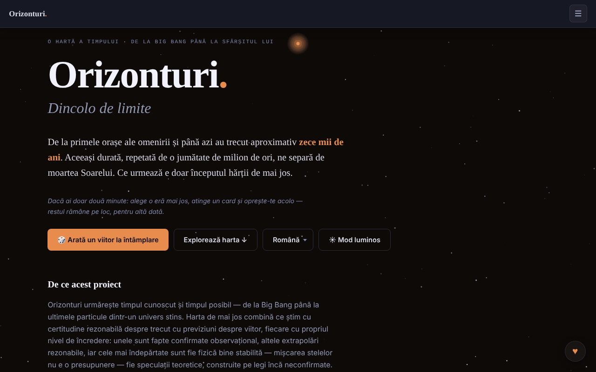

# Horizons. Beyond Limits

[English](README.md) · **Română** · [Français](README.fr.md) · [Italiano](README.it.md) · [Español](README.es.md) · [Português](README.pt.md) · [Deutsch](README.de.md) · [Magyar](README.hu.md)

**Versiune:** 1.3.3 · **Ultima actualizare:** 2026-10-22

Limbile interfeței: **Română, English, Français, Italiano, Español, Português (PT), Deutsch, Magyar**

O hartă a timpului, de la Big Bang până la sfârșitul Universului: 91 de evenimente, 8 domenii, 12 ere.

**Live:** https://chiuta.github.io/Horizons.BeyondLimits/

## Ce este

Horizons. Beyond Limits este o aplicație HTML dintr-un singur fișier care combină ce se știe cu o certitudine rezonabilă despre trecut cu predicții despre viitor, fiecare cu propriul nivel de încredere. Pe lângă harta principală, oferă ramuri alternative, o spirală a timpului 2D/3D și secțiuni despre natura Universului, paradoxuri și viața dincolo de Pământ, prezentate ca scenarii concurente, nu ca răspunsuri. Aplicația indică drept model declarat futuretimeline.net, un proiect similar în limba engleză; conținutul de aici este original.

## Funcții

- Harta timpului: 91 de evenimente, 8 domenii, 12 ere; alegerea unei ere și carduri cu detalii.
- Buton „🎲 Show me a random future" (un viitor la întâmplare).
- „Alternate Branches": traiectorii alternative, unele reconectate la harta principală.
- „The Time Spiral": spirala timpului în vizualizare 2D sau 3D (tragere, zoom, atingerea unui nod), cu „Reset view".
- „The Nature and Purpose of the Universe": scenarii, anti-scenarii, non-scenarii și imposibilități, cu filtre.
- „Paradoxes", „Life Beyond Earth and Advanced Civilizations", „Thematic Trails" și „Glossary".
- **Export Markdown:** butonul „⬇ Export the map (.md)” (tradus în cele 8 limbi) descarcă toate cele 91 de evenimente, pe ere, în limba curentă și respectând filtrul de domenii activ, cu avertismentul de speculație la final; fișierul se generează local în browser. Conținutul evenimentelor există doar în română și engleză; în celelalte limbi fișierul păstrează textul românesc, ca și harta.
- **Tipărire:** foi de stil pentru imprimare (fundal alb, text negru, fără bara de navigare, controale sau stele; cardurile nu se rup între pagini). Se tipărește era selectată, plus secțiunile de scenarii, paradoxuri și glosar; pentru toată harta folosește exportul Markdown.
- Scurtătură: `/` mută focusul în câmpul de căutare.
- Căutare, temă luminoasă/întunecată (buton ☀) și interfață în 8 limbi: English, Română, Français, Italiano, Español, Português, Deutsch, Magyar.
- Navigare cu tastatura în meniul de limbă și în file (săgeți, Home, End, Enter, Spațiu, Esc).

## Funcții noi (1.1.0)

- **Export CSV** (butonul „⬇ Export the map (.csv)”, lângă exportul Markdown): aceleași evenimente, în aceeași ordine și cu același filtru de domeniu ca exportul Markdown, în limba curentă; coloane: eră, domeniu, dată, încredere, titlu, descriere (antetul e tradus). UTF-8 cu BOM (se deschide corect în Excel/LibreOffice), separator virgulă, celulele care ar începe cu `=`, `+`, `-` sau `@` sunt prefixate cu apostrof (protecție contra formulelor). Conținutul evenimentelor există doar în română și engleză (ca la Markdown).
- **Cod QR pe carduri** (butonul ▦ de lângă ⧉ la evenimente, ramuri și scenarii): codul conține adresa publică (`https://chiuta.github.io/Horizons.BeyondLimits/`, sau a paginii curente dacă e servită de pe HTTPS) plus legătura permanentă `#titlul-cardului`, pe care aplicația o rezolvă la deschidere (deja existentă). Se poate copia și adresa. Generat local; apare doar cu modulul QR.
- **Căutare locală tolerantă la greșeli** (fără rețea, modulul `search` din fff-kit): dacă nu există nicio potrivire exactă (căutarea existentă, pe subșir, rămâne neschimbată), se afișează până la 6 potriviri apropiate pe baza cuvintelor și ortografiei (BM25, forme de cuvinte, litere lipsă/schimbate), cu mențiune clară că nu sunt exacte. Ex.: „Big Bangul”, „nucleosynthesys”. Este căutare lexicală, **nu** înțelegere semantică: nu găsește sinonime care nu seamănă ortografic. Indexul se construiește la prima nevoie (RO sau EN după limba curentă; în FR/IT/ES/PT/DE conținutul e tot cel românesc).
- **Transparență** (apăsând versiunea din subsol): rețea (0 cereri externe), stocare (nicio cheie), fișier cu SHA-256.
- Tipărirea: butoanele noi sunt ascunse în foaia de stil pentru imprimare.

Textele noi sunt în cele 8 limbi ale aplicației (RO, EN, FR, IT, ES, PT, DE, HU); în FR/IT/ES/PT/DE/HU traducerile sunt automate, **neverificate nativ**.

## Kit „fff-kit”

Module lipite în `index.html`: `core`, `label`, `bundle`, `qr`, `search` (~140 kB peste aplicație). Fără ele aplicația funcționează la fel (testat), dar fără butoanele QR și fără potrivirile apropiate; exportul CSV rămâne.

## Teste

`node tests/fff-r8.test.mjs` (Playwright, rețea blocată; 36 de verificări): CSV comparat rând cu rând cu exportul Markdown existent (titluri, descrieri, ordine, filtru), parser CSV independent, protecție formule, QR decodat înapoi și adresa lui deschisă într-o pagină nouă (cardul apare în ecran), căutare cu greșeli în EN/DE, șir fără sens (fără rezultate false), 8 limbi, axe-core 0 violări (luminos/întunecat, dialog, rezultate apropiate), 360 px, fără kit.

## Manual de utilizare

1. Alege limba din meniul de limbă (English, Română etc.).
2. Apasă „Explore the map ↓" sau „🎲 Show me a random future" pentru a începe.
3. Alege o eră din „The scale of time" și deschide un card pentru detalii.
4. Folosește linkurile „→ Timeline", „→ Alternate Branches", „→ 3D Spiral", „→ Nature of the Universe", „→ Paradoxes", „→ Life Beyond Earth", „→ Thematic Trails", „→ Glossary" pentru a sări între secțiuni.
5. În spirală comută între 2D și 3D; în 3D trage și mărește, iar „Reset view" readuce vederea.
6. În secțiunea despre Univers filtrează cu All / Scenarios / Anti-scenarios / Non-scenarios / Impossibilities.
7. Comută tema cu butonul ☀ / ☾.
8. Meniuri și file: săgeți, Home/End, Enter sau Spațiu pentru activare, Esc pentru închidere.

## Confidențialitate și rețea

- Pagina are o politică CSP (`default-src 'none'`, script permis doar prin hash `sha256`, fără `'unsafe-inline'` la scripturi; stiluri inline, imagini `data:`), fără conexiuni către alte gazde.
- Aplicația nu folosește `localStorage`, `sessionStorage` sau IndexedDB și nu face cereri de rețea (fără `fetch`, CDN sau scripturi externe); alegerile de limbă și temă nu se rețin între vizite.
- Conține doar link-uri, deschise la click, către futuretimeline.net, Buy Me a Coffee.

## Avertisment

Ficțiune / speculație: hărțile viitorului sunt extrapolări și speculații, nu predicții validate. Predicțiile pe decenii apropiate extrapolează tendințe actuale; cele pentru milenii și ere îndepărtate sunt speculative, iar secțiunile despre natura Universului și viața dincolo de Pământ prezintă cadre explicative concurente (fizică de frontieră, filozofie, teologie, ficțiune; „Dark Forest” provine dintr-un roman SF). Aceeași precizare apare în subsolul aplicației. Conținut educațional/informativ; nu înlocuiește surse științifice de referință.

## Rulare locală / offline

Descarcă `index.html` și deschide-l în browser; nu necesită internet. Imaginile `og-image*.png` din repository servesc doar previzualizării la distribuire.

## Licență

MIT — vezi fișierul `LICENSE`. © 2026 Alexandru-Ionuț Chiuță (Alexio). Eventualele biblioteci terțe incluse în fișier își păstrează licențele proprii.

## Autor

Alexio — Alexandru-Ionuț Chiuță, contact: alexio@trom.tf

## Rezumat

Horizons. Beyond Limits este o hartă a timpului într-un singur fișier HTML, de la Big Bang până la sfârșitul universului: 91 de evenimente, 8 domenii, 12 ere, ramuri alternative, o spirală temporală 2D/3D și secțiuni despre natura universului, paradoxuri și viața dincolo de Pământ. 8 limbi de interfață. Nu stochează nimic și nu face cereri de rețea; trimite doar linkuri către futuretimeline.net (modelul declarat al acestuia) și Buy Me a Coffee.

## Audit

Audit: 2026-10-10 — claimul „fără rețea / fără storage” verificat (0 `fetch`/XHR/WebSocket, 0 `localStorage`; singurele URL-uri sunt linkuri `<a>` și meta OG). Corectat contrastul culorilor, în special în tema luminoasă (accentele erelor, text secundar), verificat cu axe în ambele teme, desktop și mobil. Licența rămâne nedeclarată.

## Istoric / Changelog

### 1.3.3 — 2026-10-22

fff-kit 1.1.2: PBKDF2 600 000 iterații, protecție anti-clickjacking.

### 1.3.2 — 2026-10-22
- Mobil: textul are cel puțin 12 px, iar butoanele și câmpurile au ținte tactile mai mari pe ecrane înguste.

- **19 octombrie 2026 (v1.2.0)** — nou: pe cardul „Primii oameni pe Lună” (Apollo 11), legătura „↗ TerRa” deschide harta 2D a Pământului la 20 iulie 1969, 20:17:40 UTC (7 limbi).

- **14 octombrie 2026 (v1.1.0)** — nou: export CSV, cod QR pe carduri, căutare locală tolerantă la greșeli, fereastra „Transparență” (fff-kit: core, label, bundle, qr, search); `tests/fff-r8.test.mjs`. CSP: hash-ul scriptului recalculat.

- 1.0.0 — 2026-10-12: versiunea și data ultimei actualizări sunt afișate în aplicație
- **11 octombrie 2026** (runda 7) — butoanele de copiere au zonă de atingere de minimum 28×28 px (înainte 18×14, 104 de ținte sub 24 px la 360 px); „Arată-mi un viitor la întâmplare” (și salturile din linkuri) evidențiază cardul ales mai puternic și mai mult timp (3,6 s) și îi mută focusul; legenda spiralei are înălțime minimă de 28 px; 0 erori, axe 0 violări la 1280×800 și 360×740.
- **11 octombrie 2026** — export Markdown al hărții (filtrat după domeniu, în limba curentă), foi de stil pentru tipărire, scurtătura `/` pentru căutare, CSP cu hash pentru script (fără `'unsafe-inline'` la `script-src`); testat cu CSP activ (0 erori, axe-core 0 violări la 1280×800 și 360×740).
- **11 octombrie 2026** — etichetele de dată („acum 4,5 mld. ani”, „1 milion de ani” etc.) sunt acum localizate în toate cele 7 limbi (înainte apăreau în română și în interfața engleză); meniul ☰ se închide după alegerea limbii/temei, la Enter în căutare, la click în afară sau Esc; notificările de realizări sunt mutate deasupra butonului ♥, limitate la două, se închid la click și mai repede; textul „status” al scenariilor nu mai depășește ecranul de 360 px.
- Accesibilitate și securitate: conținutul este încadrat într-un singur reper `main` (un singur banner), subsolul și panourile auxiliare sunt în repere; a fost adăugat un meta CSP. axe-core: 0 violări la 1280×800 și 360×740. Aplicația nu are număr de versiune.

Noutăți în 1.1.0: export CSV al cronologiei (aceleași filtre ca la exportul Markdown), un cod QR pe fiecare card, care trimite la linkul său permanent, o căutare locală tolerantă la greșeli de tipar, cu „potriviri apropiate”, afișată doar când căutarea exactă nu găsește nimic (lexicală, nu semantică), și fereastra „Transparență”. Șirurile traduse automat în FR/IT/ES/PT/DE nu sunt verificate de vorbitori nativi.
